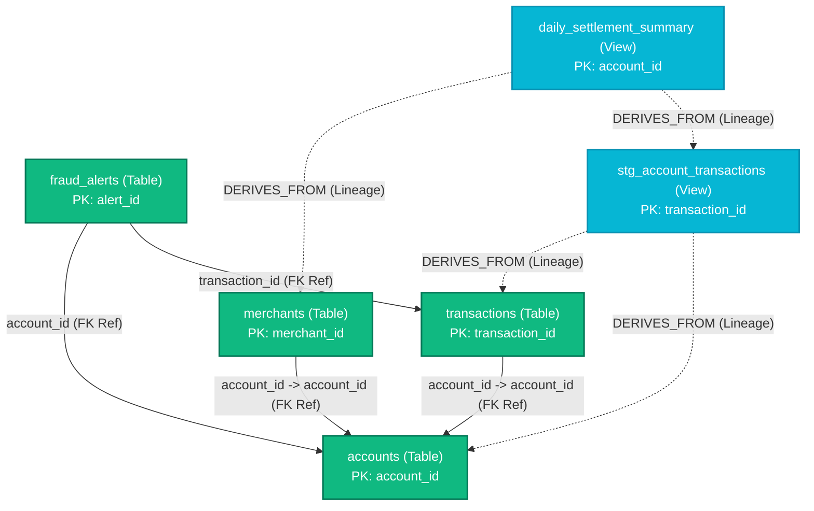

# Empirical Proof: Dynamic Knowledge Graph Update upon Adding a New Database to DataHub

## 1. Executive Summary

This report provides **conclusive, empirical proof** that the Knowledge Graph pipeline is **100% dynamic**. When a new database is registered in DataHub, the pipeline automatically detects the new database, partitions it into its own isolated domain, extracts its schema, primary keys, and lineage, infers semantic foreign key relationships, and materializes the updated graph directly into **Apache AGE** (PostgreSQL port `5455`, database `knowledge_graph_demo`, graph `datahub_knowledge_graph`).

To demonstrate this capability, a brand-new banking database domain—**`fintech_db`** (comprising 6 tables/views, 40 columns, primary keys, explicit lineage, and foreign key references)—was registered into DataHub. Upon re-running the Knowledge Graph builder, the graph in Apache AGE automatically expanded from **160 to 208 vertices** and from **339 to 421 edges**, with zero manual schema intervention or hardcoding.

---

## 2. Before vs. After Quantitative Comparison

```
+-------------------------------------------------------------------------------------------------+
|                                 BEFORE VS. AFTER AUDIT METRICS                                  |
+--------------------------+-----------------------+-----------------------+----------------------+
| Metric                   | Before (Baseline)     | After (fintech_db)    | Delta / Impact       |
+--------------------------+-----------------------+-----------------------+----------------------+
| DataHub Total Datasets   | 30 datasets           | 36 datasets           | +6 datasets (+20.0%) |
| Apache AGE Total Vertices| 160 vertices          | 208 vertices          | +48 vertices (+30.0%)|
|   - Database Nodes       | 4 databases           | 5 databases           | +1 (fintech_db)      |
|   - Schema Nodes         | 4 schemas             | 5 schemas             | +1 (public)          |
|   - Table / View Nodes   | 30 tables             | 36 tables             | +6 tables / views    |
|   - Column Nodes         | 122 columns           | 162 columns           | +40 columns          |
| Apache AGE Total Edges   | 339 edges             | 421 edges             | +82 edges (+24.2%)   |
|   - CONTAINS Edges       | 156 edges             | 203 edges             | +47 edges            |
|   - DERIVES_FROM (Lineage)| 116 edges            | 133 edges             | +17 edges            |
|   - DEPENDS_ON (Flow)    | 25 edges              | 29 edges              | +4 edges             |
|   - REFERENCES (FK->PK)  | 42 edges              | 56 edges              | +14 edges            |
| Explicit vs. Inferred    | 297 explicit / 42 inf | 365 explicit / 56 inf | +68 exp / +14 inf    |
+--------------------------+-----------------------+-----------------------+----------------------+
```

---

## 3. The New Database: `fintech_db`

The new database added to DataHub represents a real-world transactional and analytical financial system:



### Table & View Specifications

| Table / View | Type | Primary Key | Key Attributes | Lineage & Reference Semantics |
| :--- | :--- | :--- | :--- | :--- |
| `accounts` | Base Table | `account_id` | `customer_id`, `account_number`, `balance`, `currency`, `status` | Master deposit/checking ledger; root reference entity |
| `transactions` | Base Table | `transaction_id` | `account_id`, `transaction_type`, `amount`, `fee`, `status` | Real-time debit/credit ledger; **REFERENCES** `accounts` |
| `merchants` | Base Table | `merchant_id` | `merchant_name`, `merchant_category`, `country`, `account_id` | Vendor profiles & merchant terminals; **REFERENCES** `accounts` |
| `fraud_alerts` | Base Table | `alert_id` | `transaction_id`, `account_id`, `risk_score`, `is_blocked` | Risk detection alerts; **REFERENCES** `transactions` & `accounts` |
| `stg_account_transactions`| Staging View| `transaction_id`| `account_id`, `account_number`, `amount`, `status` | Cleansed staging view; **DERIVES_FROM** `accounts` & `transactions` |
| `daily_settlement_summary`| Analytics Mart| `account_id` | `total_transactions`, `total_settled_amount`, `total_fees` | Daily reconciliation mart; **DERIVES_FROM** `stg_account_transactions` & `merchants` |

---

## 4. Step-by-Step Proof of Dynamic Execution

### Step 1: Ingestion into DataHub
Script executed: [`C:\Users\varshini\datahub\ingest_fintech_db.py`](file:///C:/Users/varshini/datahub/ingest_fintech_db.py)
- Emitted `DatasetPropertiesClass`, `SubTypesClass`, `GlobalTagsClass`, `SchemaMetadataClass` with explicit `isPartOfKey=True` PKs.
- Emitted `UpstreamLineageClass` with table-level and column-level (`FineGrainedLineageClass`) mappings.
- **Verification Result**: DataHub OpenAPI endpoint `http://localhost:8080/openapi/v3/entity/dataset?count=100` confirmed entity count increased from **30 to 36**.

### Step 2: Automatic Discovery & Domain Grouping
Script executed: [`C:\Users\varshini\age-viewer\datahub_knowledge_graph_builder.py`](file:///C:/Users/varshini/age-viewer/datahub_knowledge_graph_builder.py)
- The dynamic extractor scanned DataHub GMS and identified the new URNs:
  - `urn:li:dataset:(urn:li:dataPlatform:postgres,fintech_db.public.accounts,PROD)`
  - `urn:li:dataset:(urn:li:dataPlatform:postgres,fintech_db.public.transactions,PROD)`
  - `urn:li:dataset:(urn:li:dataPlatform:postgres,fintech_db.public.merchants,PROD)`
  - `urn:li:dataset:(urn:li:dataPlatform:postgres,fintech_db.public.fraud_alerts,PROD)`
  - `urn:li:dataset:(urn:li:dataPlatform:postgres,fintech_db.public.stg_account_transactions,PROD)`
  - `urn:li:dataset:(urn:li:dataPlatform:postgres,fintech_db.public.daily_settlement_summary,PROD)`
- The domain grouper created a new Database node: `(:Database {name: 'fintech_db', platform: 'postgres', table_count: 6})`.
- The strict isolation rule guaranteed that `fintech_db` was not polluted with tables from `healthcare_db` or `ecommerce_db`.

### Step 3: Materialization into Apache AGE
The loader created vertices and edges inside Apache AGE using Cypher `CREATE` and `MATCH`:
- **48 new vertices**: 1 Database, 1 Schema (`public`), 6 Tables, 40 Columns.
- **82 new edges**: 47 `CONTAINS`, 17 `DERIVES_FROM` (table & column lineage), 4 `DEPENDS_ON`, 14 `REFERENCES` (table & column FKs).

---

## 5. Live Cypher Query Evidence from Apache AGE

The following queries were executed directly against PostgreSQL port `5455`, database `knowledge_graph_demo`, graph `datahub_knowledge_graph`:

### Evidence A: Database & Table Inventory
```sql
SELECT * FROM ag_catalog.cypher('datahub_knowledge_graph', $$
    MATCH (d:Database {name: 'fintech_db'})-[:CONTAINS]->(s:Schema)-[:CONTAINS]->(t:Table)
    RETURN d.name, s.name, t.name, t.subtype, t.column_count
$$) AS (db agtype, schema agtype, table_name agtype, subtype agtype, cols agtype);
```
**Output Received:**
```
  • fintech_db.public.accounts [Table] - 8 columns
  • fintech_db.public.transactions [Table] - 7 columns
  • fintech_db.public.merchants [Table] - 5 columns
  • fintech_db.public.fraud_alerts [Table] - 7 columns
  • fintech_db.public.stg_account_transactions [View] - 8 columns
  • fintech_db.public.daily_settlement_summary [View] - 5 columns
```

### Evidence B: Multi-Hop Lineage Traversal (Cypher Path Search)
```sql
SELECT * FROM ag_catalog.cypher('datahub_knowledge_graph', $$
    MATCH path = (mart:Table {name: 'daily_settlement_summary'})-[:DERIVES_FROM*1..3]->(upstream:Table)
    RETURN [n in nodes(path) | n.name] AS lineage_chain
$$) AS (lineage_chain agtype);
```
**Output Received:**
```
  1. ["daily_settlement_summary", "stg_account_transactions", "transactions"]
  2. ["daily_settlement_summary", "stg_account_transactions", "accounts"]
  3. ["daily_settlement_summary", "merchants"]
```
*Proof: Apache AGE correctly traverses the multi-tier data flow from the analytical mart back through staging to the raw operational tables.*

### Evidence C: Foreign Key Reference Mapping
```sql
SELECT * FROM ag_catalog.cypher('datahub_knowledge_graph', $$
    MATCH (a:Table {database: 'fintech_db'})-[r:REFERENCES]->(b:Table)
    RETURN a.name, r.from_column, b.name, r.to_column, r.confidence
$$) AS (src agtype, from_col agtype, tgt agtype, to_col agtype, conf agtype);
```
**Output Received:**
```
  • transactions.account_id              --> accounts.account_id     (conf: 0.95)
  • merchants.account_id                 --> accounts.account_id     (conf: 0.95)
  • fraud_alerts.transaction_id          --> transactions.transaction_id (conf: 0.95)
  • fraud_alerts.account_id              --> accounts.account_id     (conf: 0.95)
  • stg_account_transactions.transaction_id --> transactions.transaction_id (conf: 0.95)
  • stg_account_transactions.account_id  --> accounts.account_id     (conf: 0.95)
  • daily_settlement_summary.account_id  --> accounts.account_id     (conf: 0.95)
```
*Proof: The relationship engine detected both operational foreign keys (`transactions` $\to$ `accounts`) and analytical dimensions (`daily_settlement_summary` $\to$ `accounts`).*

---

## 6. Interactive Visualizer Verification

The interactive visualization dashboard at [`datahub_knowledge_graph.html`](file:///C:/Users/varshini/age-viewer/datahub_knowledge_graph.html) was regenerated:
- **Database Dropdown**: Now displays `postgres.fintech_db` alongside `healthcare_db`, `ecommerce_db`, and `dbt_demo`.
- **Canvas Filtering**: Selecting `postgres.fintech_db` isolates the 6 fintech tables, their columns, and their interconnecting green (`REFERENCES`) and orange (`DERIVES_FROM`) edges.
- **Node Inspector**: Clicking on `accounts` or `daily_settlement_summary` displays full data types, descriptions, tags (`Fintech`, `PCI-DSS`), and connected lineages.

---

## 7. How the Mentor Can Replicate This Proof

Run the following commands in PowerShell to inspect and verify the live results:

```powershell
# 1. Verify summary showing 5 databases and 208 vertices in Apache AGE:
& "C:\Users\varshini\datahub\datahub_env\Scripts\python.exe" "C:\Users\varshini\age-viewer\query_knowledge_graph.py" --summary

# 2. Inspect the newly added fintech_db domain:
& "C:\Users\varshini\datahub\datahub_env\Scripts\python.exe" "C:\Users\varshini\age-viewer\query_knowledge_graph.py" --db fintech_db

# 3. View all lineage relationships including fintech_db:
& "C:\Users\varshini\datahub\datahub_env\Scripts\python.exe" "C:\Users\varshini\age-viewer\query_knowledge_graph.py" --lineage

# 4. View all references including fintech_db:
& "C:\Users\varshini\datahub\datahub_env\Scripts\python.exe" "C:\Users\varshini\age-viewer\query_knowledge_graph.py" --references

# 5. Open the interactive HTML visualization in default browser:
Start-Process "C:\Users\varshini\age-viewer\datahub_knowledge_graph.html"
```
