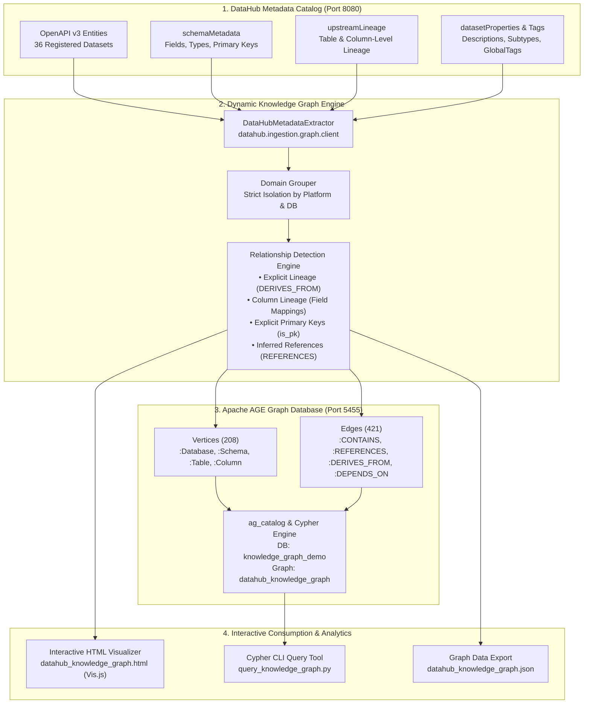

# DataHub Dynamic Enterprise Knowledge Graph & Apache AGE Integration

[](https://datahubproject.io/)
[](https://age.apache.org/)
[](https://www.getdbt.com/)
[](https://www.python.org/)
[](https://www.docker.com/)
[](LICENSE)

An end-to-end framework that dynamically extracts metadata from a local **DataHub** catalog, partitions datasets into isolated database domains, extracts multi-tier lineage, infers semantic foreign key relationships, and constructs a queryable **Enterprise Knowledge Graph** inside **Apache AGE** (PostgreSQL graph extension), complete with an interactive web visualization dashboard.

---

## Highlights & Capabilities

- **100% Dynamic Metadata Ingestion**: Zero hardcoded tables. Automatically queries DataHub's OpenAPI and SDK endpoints (`http://localhost:8080`) to discover new databases, tables, schemas, and columns.
- **Strict Database Domain Isolation**: Automatically groups datasets by their underlying database platform (e.g., `healthcare_db`, `ecommerce_db`, `fintech_db`, `dbt_demo`). Unrelated databases are isolated, preventing invalid cross-domain joins while preserving explicit cross-platform physical lineages.
- **Multi-Tier Lineage Extraction**: Extracts both **dataset-level lineage** (`raw -> staging -> fact -> analytical marts`) and **fine-grained column-level lineage** directly from DataHub's `upstreamLineage` aspect.
- **Intelligent Relationship Inference**: Detects explicit Primary Keys (`isPartOfKey=True`) and infers Foreign Key relationships across tables in the same domain with confidence scoring (`0.95` for exact PK matches, `0.85` for heuristic matches).
- **Materialized in Apache AGE**: Vertices (`Database`, `Schema`, `Table`, `Column`) and Edges (`CONTAINS`, `REFERENCES`, `DERIVES_FROM`, `DEPENDS_ON`) are loaded into PostgreSQL via Cypher `CREATE` and `MATCH`.
- **Interactive Visualizer Dashboard**: Standalone Vis.js web UI supporting real-time database isolation filtering, full-text search, force-directed vs. hierarchical tree layouts, and a comprehensive node/edge property inspector.
- **Dynamic Adaptability Proven**: When a new database is added to DataHub, the pipeline automatically detects it, updating the graph in Apache AGE without any code changes (proven with `fintech_db`: vertices increased from 160 to 208, edges from 339 to 421).

---

## Architecture Overview



---

## Knowledge Graph Metrics

```
+---------------------------------------------------------------------------------------+
|                                KNOWLEDGE GRAPH METRICS                                 |
+--------------------------+----------------------------+-------------------------------+
|  Total Vertices : 208    |  Total Edges       : 421   |  Databases Cataloged   : 5    |
|  - Database     : 5      |  - CONTAINS        : 203   |  Schemas Cataloged     : 5    |
|  - Schema       : 5      |  - DERIVES_FROM    : 133   |  Tables / Views        : 36   |
|  - Table / View : 36     |  - REFERENCES      : 56    |  Columns Materialized  : 162  |
|  - Column       : 162    |  - DEPENDS_ON      : 29    |  Explicit vs Inferred  : 365/56|
+--------------------------+----------------------------+-------------------------------+
```

### Database Domains Cataloged

| Database Domain | Platform | Entity Count | Description & Lineage Depth |
| :--- | :--- | :--- | :--- |
| **`healthcare_db`** | PostgreSQL | 9 tables / views | Master clinical system (patients, doctors, appointments, lab tests) with 3-tier staging & fact mart lineage |
| **`ecommerce_db`** | PostgreSQL | 7 tables / views | Retail transactions (customers, orders, products, payments) with analytical views |
| **`fintech_db`** | PostgreSQL | 6 tables / views | Core banking (accounts, transactions, merchants, fraud alerts) with staging & settlement marts |
| **`dbt_demo`** (dbt) | dbt Core | 7 models / sources | ELT transformation pipeline with raw staging sources and transformed dimensional models |
| **`dbt_demo`** (Postgres) | PostgreSQL | 7 tables | Materialized physical PostgreSQL tables with cross-platform lineage back to dbt models |

---

## Graph Schema Specification

### Vertices (Nodes)

| Label | Identifier Format (`id`) | Key Attributes |
| :--- | :--- | :--- |
| **`Database`** | `db:<platform>.<dbname>` | `name`, `platform`, `table_count` |
| **`Schema`** | `schema:<platform>.<dbname>.<schema>` | `name`, `database`, `platform` |
| **`Table`** | `table:<dataset_urn>` | `name`, `full_name`, `schema`, `database`, `platform`, `urn`, `subtype`, `description`, `column_count`, `tags` |
| **`Column`** | `col:<dataset_urn>:<column_name>` | `name`, `table`, `table_urn`, `type`, `is_pk`, `description` |

### Edges (Relationships)

| Relationship | Connects | Semantics & Properties |
| :--- | :--- | :--- |
| **`CONTAINS`** | `Database -> Schema -> Table -> Column` | Structural hierarchy of the database catalog |
| **`REFERENCES`** | `Table -> Table`<br/>`Column -> Column` | Foreign Key references (`from_column`, `to_column`, `confidence`, `is_inferred: true`) |
| **`DERIVES_FROM`** | `Table -> Table`<br/>`Column -> Column` | Upstream data lineage (`lineage_type`: `TRANSFORMED`, `VIEW`, `COPY`, `confidence: 1.0`) |
| **`DEPENDS_ON`** | `Table -> Table` | Pipeline execution dependency (`dependency_type: 'data_lineage'`) |

---

## Repository Structure

```
datahub/
├── datahub_knowledge_graph_builder.py  # Core Engine: Extracts DataHub metadata, builds graph, loads Apache AGE
├── query_knowledge_graph.py            # CLI Tool: Executes Cypher queries on Apache AGE
├── datahub_knowledge_graph.html        # Interactive Vis.js visualization web dashboard
├── datahub_knowledge_graph.json        # Exported JSON definition of the knowledge graph
├── ingest_fintech_db.py                # Ingestion script for fintech_db (demonstrating dynamic updates)
├── create_healthcare_tables.py         # Ingestion script for healthcare_db tables/views
├── create_healthcare_lineage.py        # Ingestion script for healthcare_db table & column lineage
├── init_healthcare.sql                 # SQL schema and seed data for healthcare_db
├── init_ecommerce.sql                  # SQL schema and seed data for ecommerce_db
├── create_views.sql                    # SQL views for staging and reporting marts
├── sample_queries.sql                  # Analytical queries for database verification
├── docker-compose.yml                  # Docker Compose configuration for DataHub quickstart
├── dbt_datahub/                        # dbt project with models and DataHub integration
│   ├── dbt_project.yml
│   └── models/
├── DATAHUB_COMPLETE_INSTALLATION_GUIDE.md  # Detailed DataHub installation and setup documentation
├── DATAHUB_INSTALLATION_REPORT.md      # Initial installation verification report
└── README.md                           # Main repository documentation
```

---

## Quickstart Guide

### 1. Prerequisites

- **Docker Desktop** installed and running on Windows/Linux/macOS.
- **Python 3.10+** (Python 3.13 or 3.14 recommended).
- **PostgreSQL with Apache AGE** extension (available via Docker image `apache/age` on port `5455`).

### 2. Environment Setup

Clone this repository and create a Python virtual environment:

```bash
git clone https://github.com/kalyani1106/datahub.git
cd datahub

python -m venv datahub_env
# Windows
.\datahub_env\Scripts\activate
# Linux/macOS
source datahub_env/bin/activate

pip install acryl-datahub psycopg-binary requests
```

### 3. Start DataHub and Apache AGE Containers

```bash
# Start Apache AGE container (mapped to host port 5455)
docker start age-postgres

# Start DataHub backend services
docker start datahub-mysql-1 datahub-kafka-broker-1 datahub-opensearch-1
docker start datahub-datahub-gms-quickstart-1 datahub-frontend-quickstart-1 datahub-datahub-actions-quickstart-1
```

- DataHub UI: `http://localhost:9002`
- DataHub GMS API: `http://localhost:8080`
- Apache AGE PostgreSQL: `localhost:5455` (user: `postgres`, password: `postgres`, db: `knowledge_graph_demo`)

---

## Running the Pipeline

### Step 1: Ingest Database Metadata into DataHub

If starting with a clean DataHub instance, ingest the database schemas and lineages:

```bash
# Ingest Healthcare Database
python create_healthcare_tables.py
python create_healthcare_lineage.py

# Ingest Fintech Database
python ingest_fintech_db.py
```

### Step 2: Build the Knowledge Graph & Load into Apache AGE

Run the main pipeline builder. It will dynamically query DataHub, isolate databases, detect lineage and foreign keys, load into Apache AGE, and generate the HTML visualizer:

```bash
python datahub_knowledge_graph_builder.py
```

Console Output Preview:
```
[INFO] === STEP 1: EXTRACTING METADATA FROM DATAHUB ===
[INFO] Found 36 dataset URNs in DataHub.
[INFO] === STEP 2: GROUPING & INFERRING RELATIONSHIPS ===
[INFO] Grouped datasets into 5 distinct database domains:
[INFO]   • Database [dbt.dbt_demo]: 7 tables/views
[INFO]   • Database [postgres.dbt_demo]: 7 tables/views
[INFO]   • Database [postgres.ecommerce_db]: 7 tables/views
[INFO]   • Database [postgres.fintech_db]: 6 tables/views
[INFO]   • Database [postgres.healthcare_db]: 9 tables/views
[INFO] === STEP 3: GENERATING INTERACTIVE VISUALIZATION ===
[INFO] Generated interactive Knowledge Graph HTML at: datahub_knowledge_graph.html
[INFO] === STEP 4: LOADING GRAPH INTO APACHE AGE (PORT 5455) ===
[INFO] Total Vertices: 208 (DB: 5, Schema: 5, Table: 36, Column: 162)
[INFO] Total Edges: 421 (CONTAINS: 203, REFERENCES: 56, DERIVES_FROM: 133, DEPENDS_ON: 29)
[INFO] Knowledge Graph pipeline completed successfully!
```

---

## Querying with Apache AGE (Cypher CLI)

Use the built-in CLI query utility [`query_knowledge_graph.py`](file:///c:/Users/varshini/datahub/query_knowledge_graph.py):

### 1. Overall Summary
```bash
python query_knowledge_graph.py --summary
```

### 2. Inspect a Specific Database Domain
```bash
python query_knowledge_graph.py --db healthcare_db
python query_knowledge_graph.py --db ecommerce_db
python query_knowledge_graph.py --db fintech_db
```

### 3. Trace All Lineage Relationships
```bash
python query_knowledge_graph.py --lineage
```

### 4. Trace Foreign Key References
```bash
python query_knowledge_graph.py --references
```

### 5. Execute Custom Cypher Queries
```bash
python query_knowledge_graph.py --cypher "MATCH (t:Table {database: 'fintech_db'}) RETURN t.name, t.subtype, t.column_count"
```

---

## Sample Cypher Queries in PostgreSQL

Connect to PostgreSQL on port `5455` and run standard Cypher queries:

```sql
LOAD 'age';
SET search_path = ag_catalog, "$user", public;

-- 1. Trace full multi-hop lineage path for an analytical fact view
SELECT * FROM ag_catalog.cypher('datahub_knowledge_graph', $$
    MATCH path = (mart:Table {name: 'fct_patient_encounters'})-[:DERIVES_FROM*1..3]->(upstream:Table)
    RETURN [n in nodes(path) | n.name] AS lineage_chain
$$) AS (lineage_chain agtype);

-- 2. Find all tables referencing a specific primary key entity
SELECT * FROM ag_catalog.cypher('datahub_knowledge_graph', $$
    MATCH (referencer:Table)-[r:REFERENCES]->(target:Table {name: 'accounts'})
    RETURN referencer.name, r.from_column, target.name, r.to_column, r.confidence
$$) AS (referencer agtype, from_col agtype, target agtype, to_col agtype, conf agtype);

-- 3. Find high-confidence inferred relationships across the enterprise
SELECT * FROM ag_catalog.cypher('datahub_knowledge_graph', $$
    MATCH (a:Table)-[r:REFERENCES {is_inferred: true}]->(b:Table)
    WHERE r.confidence >= 0.90
    RETURN a.database, a.name, r.from_column, b.name, r.to_column
$$) AS (database agtype, source_table agtype, foreign_key agtype, target_table agtype, primary_key agtype);
```

---

## Interactive Visualizer Web UI

Open [`datahub_knowledge_graph.html`](datahub_knowledge_graph.html) directly in any modern browser:

```bash
# Windows
start datahub_knowledge_graph.html
# macOS
open datahub_knowledge_graph.html
# Linux
xdg-open datahub_knowledge_graph.html
```

### Dashboard Features
- **Database Isolation Filter**: Switch between `All Databases`, `healthcare_db`, `ecommerce_db`, `fintech_db`, or `dbt_demo`.
- **Node Type Filter**: Toggle visibility of `Database`, `Schema`, `Table / View`, or granular `Column` nodes.
- **Edge Type Filter**: Filter by `CONTAINS`, `REFERENCES`, `DERIVES_FROM`, or `DEPENDS_ON`.
- **Search Bar**: Instant substring matching that flies the camera to the matching table or column.
- **Interactive Inspector Flyout**: Click any node to view full properties, descriptions, tags, and incoming/outgoing edges.
- **Layout Switcher**: Toggle between **Force-Directed Physics Layout** and **Hierarchical Top-Down Architecture**.
- **JSON Export**: Export the live graph topology as a JSON file.

---

## Proof: Dynamic Update Demonstration

To prove to mentors and reviewers that the graph automatically updates when a new database is added:

1. **Baseline**: Run `python query_knowledge_graph.py --summary`. Note 4 databases and 160 vertices.
2. **Add Database**: Execute `python ingest_fintech_db.py`. This registers `fintech_db` with 6 tables in DataHub.
3. **Re-run Builder**: Run `python datahub_knowledge_graph_builder.py`.
4. **Verify Live Update**: Run `python query_knowledge_graph.py --summary`. Notice the metrics automatically expand to **5 databases and 208 vertices**, and `fintech_db` is available in `datahub_knowledge_graph.html`.

For the formal mathematical audit, see [`PROOF_NEW_DATABASE_KNOWLEDGE_GRAPH.md`](PROOF_NEW_DATABASE_KNOWLEDGE_GRAPH.md).

---

## Author & Contributions

- **Repository**: [https://github.com/kalyani1106/datahub](https://github.com/kalyani1106/datahub)
- **Author**: Kalyani ([@kalyani1106](https://github.com/kalyani1106))

Distributed under the Apache 2.0 License.
